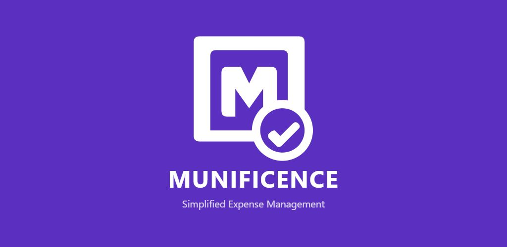
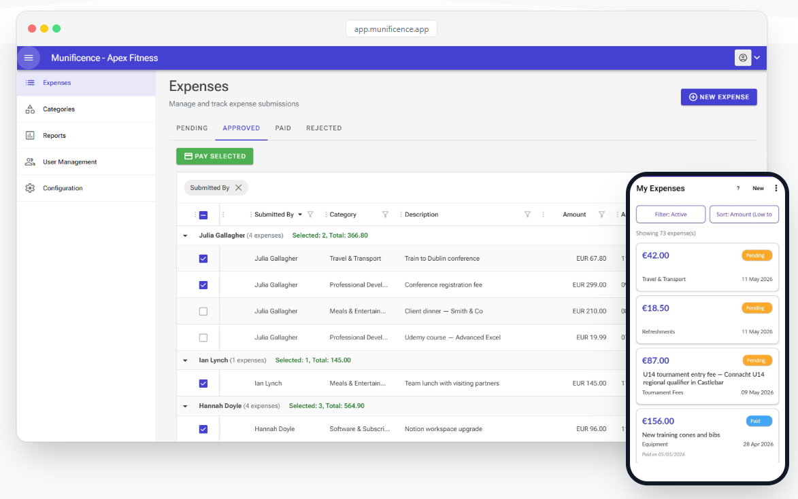
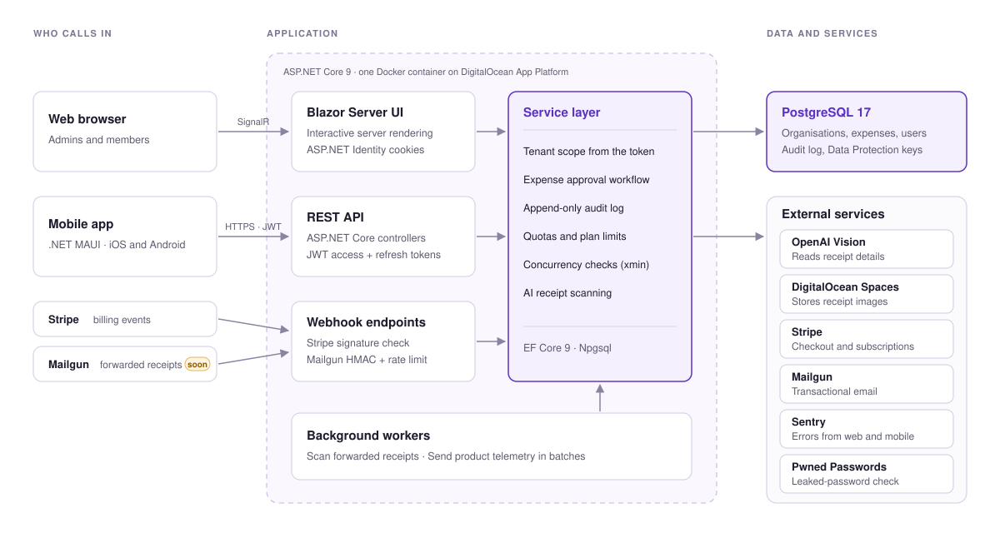

# Munificence: case study

**[munificence.app](https://www.munificence.app)** is an expense management app for clubs, charities and small organisations. Members photograph a receipt, AI fills in the details, and an admin approves and pays. It's live on the web, the App Store and Google Play. I designed, built and run it on my own alongside my day job, using AI coding assistants for much of the work.

The source is private. This page covers how it started, what the product does, how it's built, the problems that turned out to be hard, and what I learned building a production app with AI.

## How it started

My wife is treasurer of our local GAA club. She was spending her evenings chasing receipts and keeping track of who was owed what, so I built her a small web app: upload a receipt, log an expense, done. She turned out to be a demanding product owner. Approval workflows, audit trails, notifications and reporting followed, and after a couple of months it was clearly a product.

Turning a side project into a SaaS took far more than the product itself. It needed hosting, deployments, payments, transactional email, AI receipt scanning, error tracking, and eventually app store releases. The product was the easy part.

**Why it's priced per organisation.** The big expense tools, such as Expensify and SAP Concur, charge per user. That works for a company. A club with 40–50 volunteers, many of whom submit only a few expenses a year, could end up paying more for the software than some of those expenses cost. Munificence charges a flat rate per organisation, and there's a free tier.

---

## At a glance

| | |
| --- | --- |
| **Built** | February 2025 to now, solo, about 480 commits |
| **Web** | Blazor Server web app for admins and members |
| **Mobile** | .NET MAUI app on the App Store and Google Play, which replaced an early PWA |
| **Backend** | .NET 9, ASP.NET Core, EF Core, PostgreSQL 17 |
| **Integrations** | OpenAI Vision (receipt reading), Stripe (subscriptions), Mailgun (email), DigitalOcean Spaces (receipt storage), Sentry |
| **Hosting** | Docker on DigitalOcean App Platform, deploying automatically from `master` |
| **Tests** | 450+ xUnit and bUnit tests, including integration tests against real Postgres in Testcontainers |

## What it does

- **Multi-tenant.** Each organisation signs up, picks its type (club, charity, church, business and so on), and starts with a matching set of expense categories, budgets and receipt rules.
- **Expense lifecycle.** Submitted, then approved or rejected with a reason, then paid. Every status change goes into an append-only audit log recording who, when, and the old and new status.
- **AI receipt scanning.** Upload or photograph a receipt and OpenAI Vision pulls out the amount, date, description and a suggested category. The user checks the fields before submitting. A receipt in a different currency is flagged.
- **Receipts by email** (launching soon). Forward a receipt email to the organisation's private address, and each attachment becomes a draft to confirm or discard.
- **Billing.** Free and paid tiers through Stripe Checkout and webhooks. User, expense and AI-scan quotas are checked when someone acts, not just shown on screen.
- **Mobile.** Members snap receipts, submit expenses and track their status from an iOS or Android phone.

## Architecture

- **One deployable.** A single ASP.NET Core app serves the Blazor Server UI, the REST API, the webhooks and the background workers, in one Docker container.
- **The web UI and the API share one service layer.** Blazor Server components call the services directly in the same process. The mobile app reaches the same services through the REST API. Business rules live in one place, whichever way a request comes in.
- A **shared library** (`munificence.Shared`) holds the DTOs used by both the server and the mobile app, so the two agree on the API's types.
- **Tenant isolation** happens at the service layer. Every query is filtered by the `OrganizationId` claim from the caller's token, never by an ID the client sends.
- **Two auth models.** The web app uses ASP.NET Identity cookies, and the mobile app uses JWT access tokens with server-revocable refresh tokens.

---

## The hard parts

### 1. Concurrency in Blazor Server

Two admins approving the same expense at once could both succeed. Each would write an audit entry and email the submitter. The cause was subtle. In Blazor Server a scoped `DbContext` lives as long as the browser tab's circuit, which can be hours. `FindAsync` returns the cached entity without querying, so the "is this still pending?" check was testing what the tab saw when the page loaded.

A second bug made it worse. When a transaction rolled back, the change tracker wasn't cleared, so a discarded delete was replayed by the next unrelated save on that tab. It surfaced as a `DbUpdateConcurrencyException` from an approval that never touched the deleted row.

**Fix:** re-read the row explicitly before every status guard, clear the change tracker on rollback, and add a Postgres `xmin` concurrency token so the database itself rejects the second approver. A concurrency conflict now counts as a normal "someone got there first" result, not an error. Bulk "mark as paid" got the same treatment.

### 2. Tenant isolation in every endpoint

The receipt-scan endpoint took the organisation from the receipt URL the client sent. That meant a signed-in user could, in principle, have another organisation's receipt read back to them. The code was older, and a review of an unrelated release PR caught it before that release went out. The fix takes the organisation from the auth token and refuses any URL that names another one before storage or the model is touched. It returns a plain 404 and has regression tests for both the refusal and the normal case.

Lesson: every piece of client input, a URL included, has to be checked against the token's tenant.

### 3. Deploys logged everyone out

Every deploy signed every user out, broke any form left open in a tab ("the antiforgery token could not be decrypted"), and invalidated password-reset links already sent. ASP.NET Data Protection keys lived on the container's throwaway disk. Moving the key ring into Postgres fixed all three at once. The tests show that a payload protected before a simulated restart still unprotects after it.

### 4. Tests you can trust

EF Core's in-memory provider doesn't run SQL, so it can't test `ExecuteUpdateAsync`, foreign keys, unique indexes or transactions, which are exactly where the concurrency bugs were. I replaced it for integration tests with a real `postgres:17` container. Migrations run once into a template database, and each test gets its own `CREATE DATABASE … TEMPLATE` copy, so tests stay isolated and the whole suite runs in seconds. Canary tests check that the harness itself works, for example that migrations match the model and that foreign keys are enforced.

### 5. Accepting email from the internet

Receipts by email, which is about to launch, needs a webhook that accepts mail from anyone on the internet. Apart from the Stripe webhook, it's the only endpoint that doesn't require a signed-in user, so its defences are layered:

- It fails closed: if no signing key is configured, the endpoint returns 404.
- Rate limiting runs per client IP, before the body is read.
- Every request must carry a valid HMAC-SHA256 signature, with replay protection.
- The secret is each organisation's forwarding address, 128 random bits. The sender check is a second factor, because `From` headers are easy to forge.
- Attachments are checked by their actual bytes, not their file extension, and decoded only as JPEG, PNG, GIF or WebP.
- Each attachment becomes a draft in a separate table, never a live expense, until a person confirms it.

The design was written up and signed off before any code was written.

### 6. Mobile: from PWA to native

Members need to snap a receipt when they pay, not sit down at a laptop later. My first attempt was a progressive web app (PWA) built with Blazor WebAssembly. It worked, but it felt second-class next to a real app, and it wasn't a good base for the features people needed or for something robust I could ship to customers. So I rebuilt mobile as a native app in .NET MAUI. That gave me:

- direct camera and photo library access, with proper permission prompts
- sign-in tokens kept in the phone's secure storage and refreshed silently, so members stay signed in
- receipts compressed on the device before they're uploaded
- listings in the App Store and Google Play, where people expect to find an app

At least half of the mobile work was learning how to build, test, sign and release an app, then getting through each store's review. Some of the bugs along the way:

- iOS sometimes dropped the first multipart upload over HTTP/2. The fix was one retry that rewinds the stream first.
- Dates sent as date-only strings arrived with an unspecified `DateTimeKind`, which Npgsql rejects for `timestamptz`. The server now normalises them to UTC.
- Android 11+ hides other apps unless the manifest declares them, so "Contact support" reported no email app even with Gmail installed. The fix was declaring the `mailto` intent.
- Google Play blocks updates until the app targets the latest API level, which turned release planning into a deadline.

---

## Building with AI: what I learned

A few months into the project, AI coding tools got good enough to help. I started with Codex and Cursor, then moved to Claude Code for most of the recent work. Around 90 commits are co-authored by Claude. After 19 years of writing software professionally, I found using them both seductive and uncomfortable. What made the difference wasn't the model. It was the structure I put around it.

### Give it the right context

**1. Write the rules down, with examples.** The repo has a `CLAUDE.md`, structured the way Claude Code recommends. It sets non-negotiable guardrails: no hard-coded secrets, parameterised SQL only, every endpoint authenticated, every query scoped to the tenant, no personal data in logs. Supporting files cover the architecture, auth, data model, UI and clean-code conventions, with examples of how I want things built. Examples work better than descriptions. Before these files existed I was correcting the same mistakes in every session. Afterwards the assistant checked new code against them itself.

**2. Make the documentation keep itself current.** Documentation that describes last quarter's app is worse than none, because the AI trusts it. A checked-in skill compares the documentation with the code and fixes the gaps. It's run after a .NET upgrade, a new package, a new module or an architecture change.

**3. A rule in a document is a suggestion. A test that fails the build is a rule.** `architecture.md` said the web UI and the mobile API share one service layer, and the code drifted anyway. Receipt storage ended up written three times, once each for the web form, the mobile API and forwarded email. When I fixed photos keeping their GPS location, the fix reached the app and email but not the web form. It only came to light because I asked whether the fix applied to every way a receipt comes in. The AI hadn't flagged it, partly because of my own instructions: "match the surrounding code" told it to copy the pages that already went straight to the database. The rule now lives in three places. The architecture doc states it. The `/code-review` checklist treats a break as a failure, even where neighbouring code does the same. And guard tests fail the build when a page or controller reaches for the database, file storage, the AI service or the image library. Pages that already broke the rule sit on an allowlist that can only shrink, because the test also fails when an entry is no longer needed.

**4. Keep a written plan the AI can update.** A living `PLAN.md` holds the current state, sprint items, who does what and what's been verified. A long session can hand over to a fresh one with that file and nothing else, which beats trying to make one conversation remember everything.

### AI writes, AI reviews, then I review

**5. Turn reviews into skills, then experiment with them.** Code review, security review, new endpoint, new test, commit, PR, and "run it locally and click through it" are each a checked-in skill. A review uses the same checklist every time, not whatever I remember to ask for. That's how the cross-tenant scan bug, which had been there for months, got caught. I compare reviews of the same change with no skill and with different versions of a skill, see what each one catches, and fold that back into the skill.

**6. Test your skills, because models change.** A review skill that worked well two months ago may not work as well on today's model. Running skills against a fixed set of changes with known problems shows whether they still catch them.

**7. Match the depth of review to the risk.** A change backed by unit tests, integration tests and end-to-end tests of real user journeys can get a quick AI review. Security-sensitive or business-critical code gets a deep, risk-based review: I work out what the change is meant to do and dig into the code myself.

**8. Make everything verifiable.** Two questions matter. Can I verify that the feature does what it's meant to? And can I verify every claim the AI's review makes? When a claim can't be checked, I push the AI until it can, or I drop it.

### Tests and proof

**9. Make the AI question its own tests.** AI-written tests can pass without proving anything. I ask the AI: are these tests valid, are the mocks bypassing the logic they're supposed to test, and is the coverage broad enough? Then I put those questions into skills. Integration tests that feed real data through the whole stack matter most. That's why the suite runs against a real Postgres database rather than a fake.

**10. "Done" means it runs in front of you.** The model is confident whether or not it's right. A change isn't done until someone has seen it work: a real-database test, a click-through in the browser, a check on a real phone. "Fixed and checked on the phone, three launches" became the bar.

### Ownership

**11. Ask for the why in commit messages.** The AI-assisted commits explain the cause, not just the change. The concurrency fix's message is effectively a postmortem. Months later, that's the most valuable thing in the history.

**12. AI makes bad merges at AI speed.** In May 2026 an AI-generated branch was merged, reverted and re-merged until changes were silently lost, and I had to rebuild them by hand from the history. Since then: one branch per task, small PRs, and I review every merge into `develop`.

**13. You still own the decisions.** Security sign-offs, anything that touches production, rotating credentials and store releases stay with me. The AI writes the checklist and does the legwork, but it doesn't get to tick the boxes that matter.

---

*Questions about the project: open an issue on this repo or contact me via my [GitHub profile](https://github.com/JonathanKeav).*
